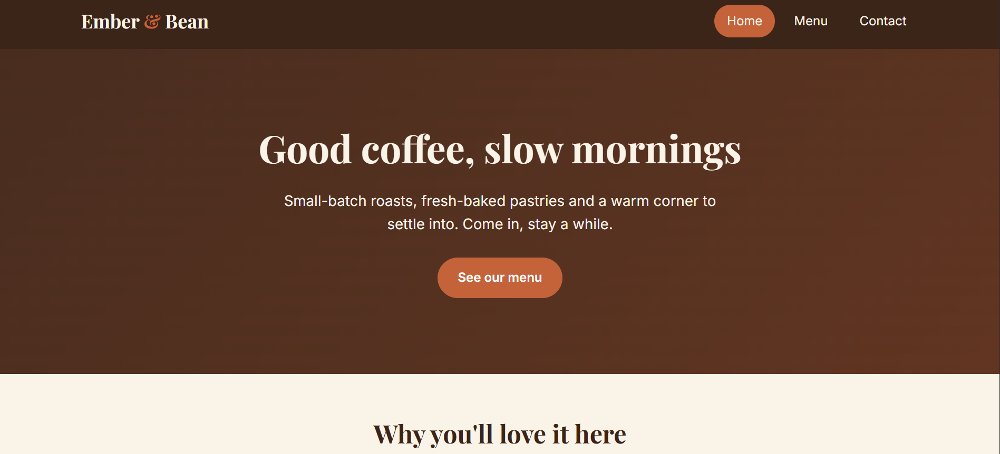
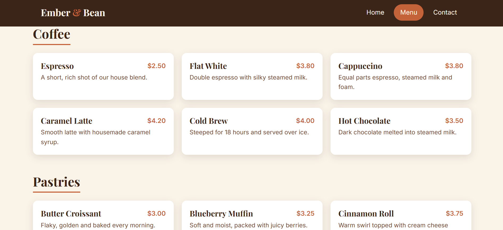
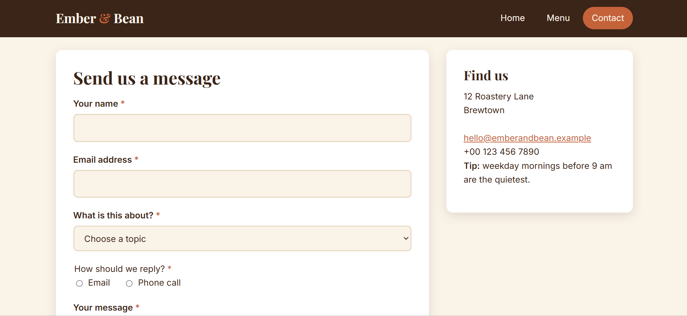
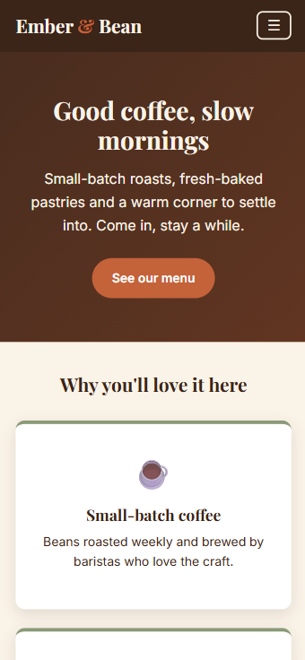
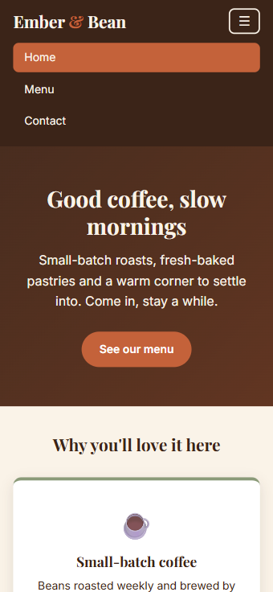
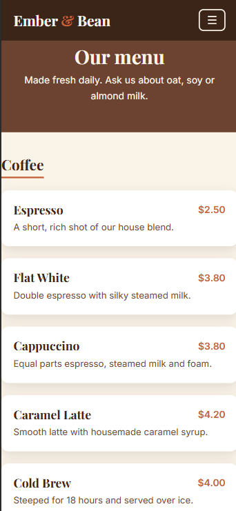

# Ember & Bean Café

A small, responsive, multi-page website for a fictional café, built with plain HTML, CSS and a little JavaScript. No frameworks, no build step.

<!-- Add your live link here once the site is hosted, for example with GitHub Pages:
**Live demo:** https://your-username.github.io/your-repo-name/ -->



## Pages

| Page | What it has |
| --- | --- |
| **Home** (`index.html`) | Hero section, three highlight cards, and an opening-hours table |
| **Menu** (`menu.html`) | Items grouped into Coffee, Pastries and Light Bites, laid out with CSS Grid |
| **Contact** (`contact.html`) | A form with name, email, topic dropdown, reply-method radio buttons and a message box |

All three pages share the same navbar and footer.

## Screenshots

| Menu                                       | Contact                                          |
| ------------------------------------------ | ------------------------------------------------ |
|  |  |

### On a phone

| Home | Menu open | Menu page |
| --- | --- | --- |
|  |  |  |

## Features

- **Semantic HTML:** `header`, `nav`, `main`, `section` and `footer` on every page.
- **Flexbox navbar** that collapses into a hamburger menu on phones.
- **CSS Grid** menu: 3 columns on desktop, 2 on tablet, 1 on phone.
- **Accessible form:** every field has a proper `label`, required fields use the `required` attribute, and the radio buttons are grouped in a `fieldset` with a `legend`.
- **Two media queries:** tablet (900px and below) and phone (600px and below).
- **One source of truth for style:** the colour palette, fonts, spacing and shadow are defined once as CSS variables in `:root`.
- **Accessibility touches:** `aria-current` marks the current page, `aria-expanded` and `aria-controls` describe the mobile menu button, and keyboard focus is visible.

## Built with

- HTML5
- CSS3 (Flexbox, Grid, custom properties, media queries)
- Vanilla JavaScript (mobile menu toggle and a friendly form confirmation)
- [Google Fonts](https://fonts.google.com/): Playfair Display and Inter

## Project structure

```
cafe-website/
├── index.html
├── menu.html
├── contact.html
├── css/
│   └── styles.css
├── js/
│   └── main.js
├── screenshots/
└── README.md
```

## Run it locally

1. Clone or download this repository.
2. Open `index.html` in your browser.

That's it. There is nothing to install.

## Notes

- The café, its address and its prices are made up for practice.
- The contact form doesn't send data anywhere. `main.js` shows a thank-you message and clears the form, because the site has no backend.

## What I practised

- Structuring a multi-page site with semantic HTML
- Building responsive layouts with Flexbox and CSS Grid
- Writing mobile-first-friendly media queries
- Managing a design system with CSS variables
- Building accessible forms and navigation

## Ideas for next steps

- Replace the hero gradient with a real photo and add images to the menu items
- Add a menu filter (for example, show only Coffee)
- Connect the contact form to a form service so messages are actually delivered
